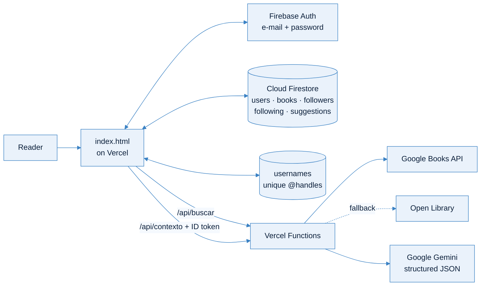
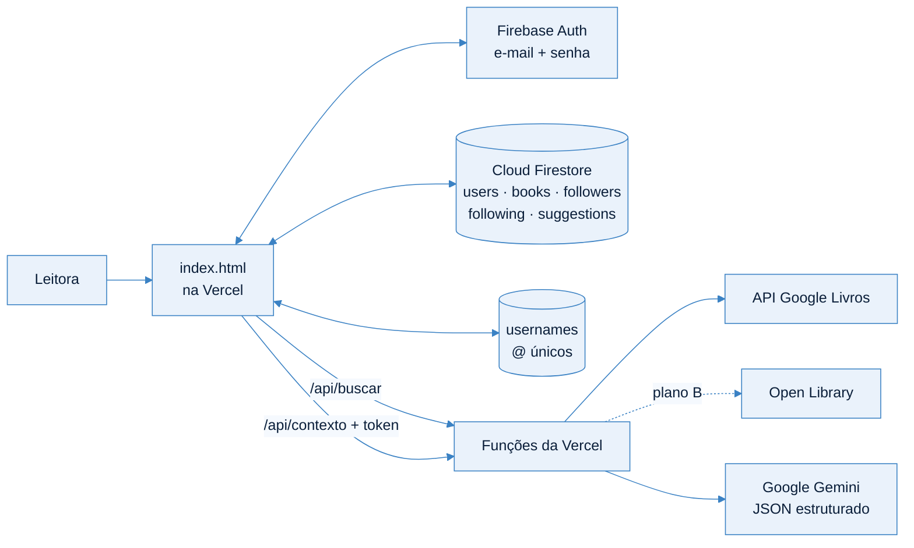

  

### <a href="#english">🇺🇸 English</a> &nbsp;|&nbsp; <a href="#portugues">🇧🇷 Português</a>

 

 

### 📚 [**Open the app / Abrir o app**](https://minhabiblioteca-pearl.vercel.app)

 

<!-- ======================================================== -->
<!-- ======================= ENGLISH ======================== -->
<!-- ======================================================== -->

# 🇺🇸 English

## 📖 About the project

> *"A book doesn't end on the last page. It ends when you know what it meant to you, and share it."*

**Minha Biblioteca** ("My Library") is a personal **virtual bookshelf**. Each book I read becomes a spine on the
shelf, and clicking it **pulls the book out** and turns it into its cover, with all the details of that reading.

I wanted more than a list of titles: a place to record **when** I read each book, **what I thought of it** and
**why**, scoring it on the same criteria every time so books can be compared fairly.

- 📚 **Interactive shelf** of book spines, with color, width and height based on each book
- 🗂️ **Book card** with title, author, publication date, page count, category, reading dates and synopsis
- ⭐ **Ratings from 0 to 5** for plot, reading development, writing flow, pace, chapter organization and character (or argument) building
- 🧮 **Final score** calculated automatically from the rated criteria
- 💬 **Personal comments** saved automatically
- 👥 **Social layer**: a unique @username, follow requests you can **accept or decline**, access to the shelves and reviews of the people you follow, and book suggestions between friends
- 🔐 **Login and password**, and your books stay private until you approve a follower

 

## 🧩 How it was built

<table>
<tr>
<td align="center" width="20%">💡 <b>Inspiration</b> A virtual library seen online</td>
<td align="center">➜</td>
<td align="center" width="20%">📝 <b>Criteria</b> What a good review needs</td>
<td align="center">➜</td>
<td align="center" width="20%">🎨 <b>Interface</b> Shelf, spines and book card</td>
<td align="center">➜</td>
<td align="center" width="20%">🔐 <b>Login + data</b> Firebase Auth & Firestore</td>
<td align="center">➜</td>
<td align="center" width="20%">🚀 <b>Deploy</b> GitHub + Vercel</td>
</tr>
</table>

I built it with **vanilla HTML, CSS and JavaScript**, with **Claude (Anthropic)** as a coding copilot. Like my
other projects, it runs entirely on **free tiers**: no paid licenses, no server to maintain.

 

## 🛠️ Tech Stack

<table>
<tr>
<td width="50%" valign="top">

### 💻 Frontend

</td>
<td width="50%" valign="top">

### ☁️ Backend & Hosting

</td>
</tr>
<tr>
<td width="50%" valign="top">

### 🔎 Data & AI

</td>
<td width="50%" valign="top">

### 🧰 Tools

</td>
</tr>
</table>

 

## ✨ Features

| | Feature | How it works |
|:---:|---|---|
| 📚 | **Two shelves** | "Read / reading now" (with a ribbon on books in progress) and a **"Want to read"** shelf |
| 🎬 | **Pull-out animation** | The spine lifts, flies to the center and rotates into the book's cover |
| 🔎 | **Auto-fill** | Search by title: a Vercel function queries **Google Books** (with its own key) and falls back to **Open Library**, filling title, author, year, pages, synopsis, category and cover |
| 🏛️ | **Work context (AI)** | **Gemini** writes the book's context (historical moment, what was new, why it stands out) and a spoiler-free synopsis in Portuguese, with automatic retry and fallback models |
| 🖼️ | **Cover upload** | The photo is resized in the browser and the **spine color is taken from the cover** |
| ⭐ | **Rating by criteria** | 6 criteria from 0 to 5 (half points), plus **custom criteria** of your own |
| ⏱️ | **Reading time** | Days between start and finish, pages per day, "reading for X days" on books in progress and your average per book |
| 📲 | **Share to Instagram** | Generates an image with cover, title, score, stars and comment in **Stories/Reels (9:16)**, **Post (4:5)** or **Square**, with book-color, light or dark backgrounds; share directly or download |
| 🧮 | **Final score** | Average of the rated criteria only, so unrated ones don't pull the score down |
| 🏷️ | **Search & filters** | By title, author or category, with category chips |
| ⌨️ | **Navigation** | Previous / Next (also with arrow keys) and a "Look it up" shortcut |
| 📝 | **One form for everything** | Book data, ratings and comments are filled in together; clicking a book shows only the final card |
| 👤 | **Unique @username** | Reserved in a `usernames` collection, so no two people share the same handle |
| 🤝 | **Follow requests** | Ask to follow; the other person sees the request and chooses **Allow** or **Decline** |
| 💌 | **Book suggestions** | People connected by a follow can recommend a book with a note; the receiver adds it to "Want to read" in one click, and the card shows who suggested it |
| ❤️ | **Likes & replies** | Followers can like a book, like your review and reply to it in a thread; you can delete any reply on your books |
| 📄 | **PDF link** | Attach a PDF link to a book; only you and approved followers see the download button |
| 📰 | **Activity feed** | Recent reads and final scores from everyone you follow |
| 👀 | **Read-only profiles** | Open a friend's shelf, book cards, ratings and comments without being able to edit them |
| 🔐 | **Security** | Firebase Auth with e-mail and password; Security Rules only let **approved followers** read someone's books |

 

## 🧭 Architecture

The front end lives in **a single HTML file**, with no build step; two small **Vercel Functions** (`api/`) keep the API keys on the server. A small storage layer switches between
**Firebase** (when configured) and **localStorage** (demo mode), so the same code runs in both.

 

## 🧠 What I learned

| Concept | In this project |
|---|---|
| 🔐 **Authentication** | Sign up, sign in, sign out and password reset with Firebase Auth |
| 🛡️ **Security Rules** | Books readable only by the owner and **accepted followers**; follow status can only be changed by the right person |
| 👥 **Social data modeling** | Mirrored `followers` / `following` subcollections written atomically with batched writes |
| 🤖 **Generative AI** | Gemini with a JSON schema, a prompt that asks it not to invent facts, and the key kept on the server |
| 🌐 **Consuming APIs** | Fetching and cleaning Google Books data to fill in a form |
| 🎬 **UI animation** | Web Animations API for the pull-out and cover-flip effect |
| 🖼️ **Image processing** | Resizing covers with Canvas and extracting the dominant color |
| 🧮 **Scoring logic** | A final score that ignores unrated criteria |
| 🧱 **Abstraction** | One storage interface for two backends (Firebase and localStorage) |

 

<a href="#portugues">🇧🇷 Ler em Português</a> &nbsp;|&nbsp; <a href="#english">⬆️ Back to top</a>

 

---

 

<!-- ======================================================== -->
<!-- ====================== PORTUGUÊS ======================= -->
<!-- ======================================================== -->

# 🇧🇷 Português

## 📖 Sobre o projeto

> *"Um livro não acaba na última página. Acaba quando você entende o que ele significou para você, e compartilha."*

O **Minha Biblioteca** é uma **estante virtual** pessoal. Cada livro que eu leio vira uma lombada na estante e,
ao clicar, o livro **sai da estante** e vira a capa, com todos os detalhes daquela leitura.

Eu queria mais do que uma lista de títulos: um lugar para registrar **quando** li cada livro, **o que achei** e
**por quê**, avaliando sempre pelos mesmos critérios para conseguir comparar um livro com outro de forma justa.

- 📚 **Estante interativa** de lombadas, com cor, largura e altura de acordo com cada livro
- 🗂️ **Ficha do livro** com título, autor(a), data de publicação, páginas, categoria, datas de leitura e sinopse
- ⭐ **Notas de 0 a 5** para enredo, desenvolvimento da leitura, fluidez do texto, ritmo, organização dos capítulos e construção de personagens (ou argumentos)
- 🧮 **Nota final** calculada automaticamente a partir dos critérios avaliados
- 💬 **Comentários pessoais** salvos automaticamente
- 👥 **Lado social**: um @nome de usuário único, pedidos para seguir que você pode **permitir ou recusar**, acesso às estantes e avaliações de quem você segue, e sugestões de livros entre amigos
- 🔐 **Login e senha**, e seus livros ficam privados até você aprovar um seguidor

 

## 🧩 Como foi construído

<table>
<tr>
<td align="center" width="20%">💡 <b>Inspiração</b> Uma biblioteca virtual vista na internet</td>
<td align="center">➜</td>
<td align="center" width="20%">📝 <b>Critérios</b> O que uma boa avaliação precisa</td>
<td align="center">➜</td>
<td align="center" width="20%">🎨 <b>Interface</b> Estante, lombadas e ficha</td>
<td align="center">➜</td>
<td align="center" width="20%">🔐 <b>Login + dados</b> Firebase Auth e Firestore</td>
<td align="center">➜</td>
<td align="center" width="20%">🚀 <b>Deploy</b> GitHub + Vercel</td>
</tr>
</table>

Desenvolvi com **HTML, CSS e JavaScript puros**, usando o **Claude (Anthropic)** como copiloto de código. Assim
como meus outros projetos, roda inteiro em **planos gratuitos**: sem licenças pagas e sem servidor para manter.

 

## 🛠️ Tecnologias

<table>
<tr>
<td width="50%" valign="top">

### 💻 Frontend

</td>
<td width="50%" valign="top">

### ☁️ Backend e Hospedagem

</td>
</tr>
<tr>
<td width="50%" valign="top">

### 🔎 Dados e IA

</td>
<td width="50%" valign="top">

### 🧰 Ferramentas

</td>
</tr>
</table>

 

## ✨ Funcionalidades

| | Funcionalidade | Como funciona |
|:---:|---|---|
| 📚 | **Duas estantes** | "Lidos / lendo agora" (com fitinha marcadora nos livros em andamento) e a estante **"Quero ler"** |
| 🎬 | **Animação de tirar da estante** | A lombada sobe, voa até o centro e gira até virar a capa do livro |
| 🔎 | **Preenchimento automático** | Busca pelo título: uma função na Vercel consulta o **Google Livros** (com chave própria) e, se falhar, o **Open Library**, preenchendo título, autor, ano, páginas, sinopse, categoria e capa |
| 🏛️ | **Contexto da obra (IA)** | O **Gemini** escreve o contexto da obra (momento histórico, o que trouxe de novo, por que se destaca) e uma sinopse sem spoilers em português, com nova tentativa automática e modelos reserva |
| 🖼️ | **Envio de capa** | A foto é redimensionada no próprio navegador e a **cor da lombada é tirada da capa** |
| ⭐ | **Avaliação por critérios** | 6 critérios de 0 a 5 (de meio em meio ponto), além de **critérios personalizados** |
| ⏱️ | **Tempo de leitura** | Dias entre o início e o fim, páginas por dia, "lendo há X dias" nos livros em andamento e a sua média por livro |
| 📲 | **Compartilhar no Instagram** | Gera uma imagem com capa, título, nota, estrelas e comentário em **Stories/Reels (9:16)**, **Post (4:5)** ou **Quadrado**, com fundo na cor do livro, claro ou escuro; compartilha direto ou baixa |
| 🧮 | **Nota final** | Média só dos critérios avaliados, para os que ficaram sem nota não puxarem a média para baixo |
| 🏷️ | **Busca e filtros** | Por título, autor ou categoria, com botões de categoria |
| ⌨️ | **Navegação** | Anterior / Próximo (também pelas setas do teclado) e atalho "Pesquisar" |
| 📝 | **Um formulário para tudo** | Dados do livro, notas e comentários são preenchidos juntos; ao clicar no livro, aparece só a ficha final |
| 👤 | **@nome de usuário único** | Reservado numa coleção `usernames`, então duas pessoas nunca têm o mesmo @ |
| 🤝 | **Pedidos para seguir** | Você pede para seguir; a outra pessoa vê o pedido e escolhe **Permitir** ou **Recusar** |
| 💌 | **Sugestões de livros** | Quem se segue pode indicar um livro com um recado; quem recebe coloca na estante "Quero ler" com um clique, e a ficha mostra quem sugeriu |
| ❤️ | **Curtidas e respostas** | Seguidores podem curtir o livro, curtir o seu comentário e responder numa conversa; você pode apagar qualquer resposta nos seus livros |
| 📄 | **Link do PDF** | Adicione o link de um PDF ao livro; só você e seus seguidores aprovados veem o botão de baixar |
| 📰 | **Atividade** | Leituras recentes e notas finais de todo mundo que você segue |
| 👀 | **Perfis somente leitura** | Abra a estante de uma amiga, as fichas, notas e comentários, sem poder editar nada |
| 🔐 | **Segurança** | Firebase Auth com e-mail e senha; as Security Rules só deixam **seguidores aprovados** lerem os livros de alguém |

 

## 🧭 Arquitetura

O front-end fica em **um único arquivo HTML**, sem etapa de build; duas pequenas **funções da Vercel** (`api/`) guardam as chaves de API no servidor. Uma camada de armazenamento alterna entre o
**Firebase** (quando configurado) e o **localStorage** (modo demonstração), então o mesmo código funciona nos dois.

 

## 🚀 Como rodar o seu

1. Crie um projeto no [Firebase](https://console.firebase.google.com), ative **Authentication → E-mail/senha** e crie o **Firestore**.
2. Cole o conteúdo de `firestore.rules` na aba **Regras** do Firestore e publique.
3. No `index.html`, troque `const FIREBASE_CONFIG = null;` pelo objeto de configuração do seu app Web.
4. Publique na **Vercel** (Framework: *Other*) e adicione o domínio em **Authentication → Configurações → Domínios autorizados**.
5. Na Vercel, em **Settings → Environment Variables**, crie `GEMINI_API_KEY` (chave do Google AI Studio) e `GOOGLE_BOOKS_API_KEY` (chave do Google Cloud com a Books API ativada). Depois faça um novo deploy.

Sem configuração, o app roda em **modo demonstração**, com os dados salvos só no navegador.

 

## 🧠 O que aprendi

| Conceito | Neste projeto |
|---|---|
| 🔐 **Autenticação** | Cadastro, login, logout e redefinição de senha com Firebase Auth |
| 🛡️ **Security Rules** | Livros visíveis só para a dona e **seguidores aceitos**; o status do pedido só pode ser mudado pela pessoa certa |
| 👥 **Modelagem de dados social** | Subcoleções espelhadas `followers` / `following` gravadas juntas com batched writes |
| 🤖 **IA Generativa** | Gemini com schema JSON, prompt que pede para não inventar fatos e a chave guardada no servidor |
| 🌐 **Consumo de APIs** | Buscar e tratar os dados do Google Livros para preencher um formulário |
| 🎬 **Animação de interface** | Web Animations API para o efeito de tirar o livro da estante e virar a capa |
| 🖼️ **Tratamento de imagem** | Redimensionar capas com Canvas e extrair a cor predominante |
| 🧮 **Lógica de pontuação** | Uma nota final que ignora critérios sem nota |
| 🧱 **Abstração** | Uma mesma interface de armazenamento para dois back-ends (Firebase e localStorage) |

 

## 👩‍💻 Autora

Feito com 📚 por **Amanda Pasqualotto**

  

<a href="#english">🇺🇸 Read in English</a> &nbsp;|&nbsp; <a href="#portugues">⬆️ Voltar ao topo</a>

